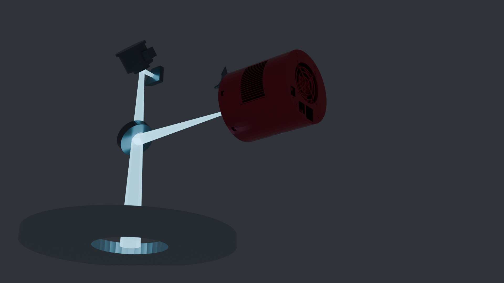
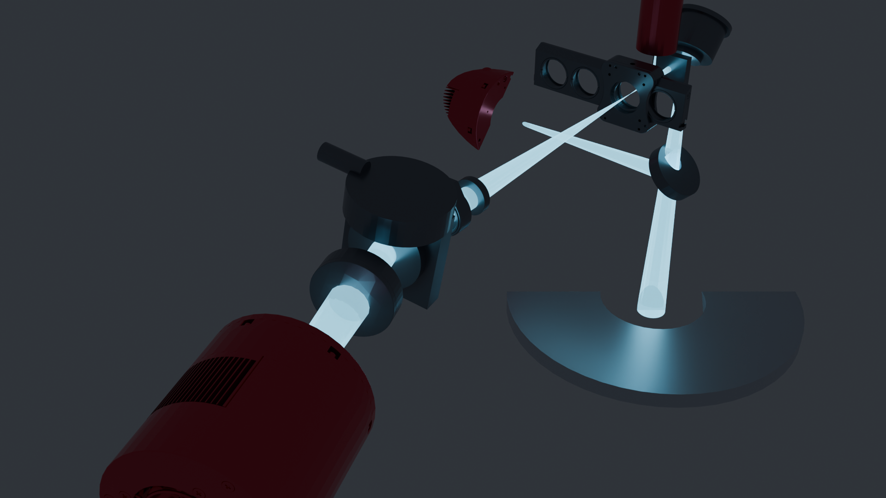
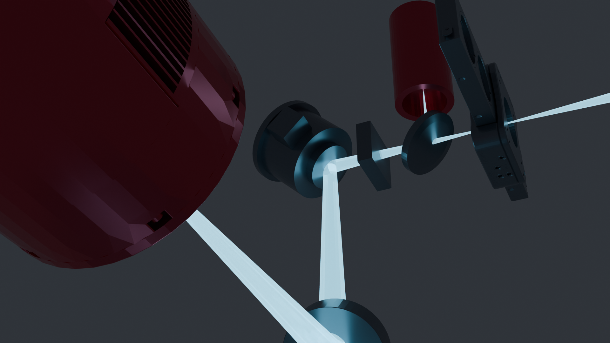

# Mt. Abu 1.2m Slit Spectrograph, Tip-Tilt Guider & Annular Field Imager
### 3D CAD Assembly & Direct-Focus Optical Architecture

Parametric 3D mechanical and optical CAD assembly developed in **FreeCAD** with photorealistic **Blender Cycles** rendering for the **Physical Research Laboratory (PRL), Mount Abu Observatory (Gurushikhar) 1.2m Cassegrain Telescope**.

---

## Photorealistic Renders

| Isometric Overview | Top Plan View (X-Y) |
| :---: | :---: |
|  |  |

| Spectrograph Deck Detail | Pick-Off & Calibration Injection |
| :---: | :---: |
|  |  |

---

## 1. Telescope & Optical Parameters

| Parameter | Value | Notes |
| :--- | :--- | :--- |
| **Primary Aperture ($D_{\text{tel}}$)** | $1200\text{ mm}$ ($1.2\text{ m}$) | Cassegrain configuration |
| **Focal Ratio** | $f/13$ | Marginal cone half-angle $= 2.20^\circ$ ($38.4\text{ mrad}$) |
| **Effective Focal Length ($f_{\text{tel}}$)** | $15,600\text{ mm}$ | |
| **Focal-Plane Plate Scale** | $13.22\text{ arcsec/mm}$ | $75.63\ \mu\text{m/arcsec}$ ($1.0\text{ arcmin} = 4.538\text{ mm}$) |
| **Cassegrain Flange Datum** | $Z = -350.0\text{ mm}$ | $350\text{ mm}$ back-focus upstream of focal plane |
| **Flange Clear Aperture** | $\varnothing 100\text{ mm}$ ID ($\varnothing 280\text{ mm}$ OD) | Zero vignetting over full $43.3\text{ mm}$ sensor diagonal |
| **Operating Environment** | $0^\circ\text{C}$ to $+5^\circ\text{C}$ (Gurushikhar winter) | Piezo actuators rated $-20^\circ\text{C}$ to $+80^\circ\text{C}$ |

---

## 2. Direct-Focus Optical Architecture

This layout eliminates unnecessary macro relay lenses and secondary fold mirrors, placing detectors and slits directly at telescope optical focus:

1. **Branch A — Annular Field Imager (Acquisition & Offset Guiding):**
   - **`M1_PiercedMirror`** sits at $Z = -200\text{ mm}$ at $45^\circ$, intercepting the converging $f/13$ cone.
   - It features an **$\varnothing 18.0\text{ mm}$ ($4.0\text{ arcmin}$)** central hole bored parallel to the incoming beam ($+Z$, $45^\circ$ to mirror face) with rear chamfering.
   - The outer annular beam reflects into $+X$ over a $200\text{ mm}$ throw directly to the **ZWO ASI6200MM Pro** full-frame camera ($36 \times 24\text{ mm}$) at focal position $(200, 0, -200)\text{ mm}$.
   - Delivers a **$7.93' \times 5.29'$ total field** with a central $4.0'$ hole, providing **$29.6\text{ sq. arcmin}$ active annular sky coverage** ($70.5\%$ of sensor).

2. **Branch B — Central Beam Tip-Tilt & Calibration Injection:**
   - Central $4.0'$ beam passes unvignetted through the hole to a **PI S-335.2SHM2 Fast Steering Mirror** at $Z = -90\text{ mm}$, folded $90^\circ$ into $+Y$.
   - **Thorlabs MFF101/M** motorized flip mirror injects $f/13$ calibration light ahead of the slit.
   - **Thorlabs BP108 / Edmund #39-480** $2\text{–}5\ \mu\text{m}$ nitrocellulose pellicle beamsplitter reflects 8% along $+Z$ to a **ZWO ASI290MM Mini** fine guider camera at focal position $(0, 55, -55)\text{ mm}$.
   - 92% transmitted light reaches the **Thorlabs S150R** $150\ \mu\text{m} \times 3\text{ mm}$ air slit ($2.0'' \times 40''$) at telescope focus $(0, 90, -90)\text{ mm}$.

3. **Branch C — Compact Low-Resolution Spectrograph ($R \approx 500$):**
   - **Collimator:** $\varnothing 30\text{ mm}$, $f = 200\text{ mm}$ achromatic doublet (`AC300-200-A`) producing a $15.38\text{ mm}$ collimated beam.
   - **VPH Grating:** $600\text{ lines/mm}$ @ $600\text{ nm}$ CWL, placed only $50\text{ mm}$ past collimator. Total beam deviation $= 20.8^\circ$ toward $-X$.
   - **Camera Lens:** $\varnothing 50.8\text{ mm}$, $f = 100\text{ mm}$ achromatic doublet (`AC508-100-A`, $f/6.5$, $0.5\times$ demagnification), placed $45\text{ mm}$ past grating.
   - **Detector:** **ZWO ASI2600MM Pro** (APS-C cooled mono, $23.5 \times 15.7\text{ mm}$, $3.76\ \mu\text{m}$ pixels) capturing $450\text{–}750\text{ nm}$ with zero vignetting. Total spectrograph arm shortened by $135\text{ mm}$ compared to traditional layouts.

---

## 3. Global Optical Stations

60: | Station ID | Position $(X, Y, Z)$ (mm) | Optical Axis Direction | Component |
61: | :--- | :--- | :--- | :--- |
62: | **`Flange_Ring`** | `(0.0, 0.0, -350.0)` | `(0, 0, +1)` | Cassegrain Mounting Flange ($\varnothing 280\text{ mm}$) |
63: | **`M1_PiercedMirror`** | `(0.0, 0.0, -200.0)` | `(0, 0, +1)` | $2''$ Flat Mirror w/ $\varnothing 18\text{ mm}$ $45^\circ$ Bore |
64: | **`C_FF_ASI6200MM`** | `(200.0, 0.0, -200.0)` | `(+1, 0, 0)` | Field Imager Sensor ($36 \times 24\text{ mm}$) |
65: | **`FSM_PI_S335`** | `(0.0, 0.0, -90.0)` | `(0, 0, +1)` | PI S-335.2SHM2 Piezo Tip-Tilt Platform |
66: | **`CAL_LinearStage_Envelope`** | `(0.0, 25.0, -90.0)` | `(0, +1, 0)` | Reserved Envelope for Calibration Mirror |
67: | **`BS_Pellicle_92_8`** | `(0.0, 55.0, -90.0)` | `(0, +1, 0)` | $\varnothing 25.4\text{ mm}$ 8R/92T Pellicle Beamsplitter (Thorlabs BP108) |
68: | **`C_GD_ASI290MM`** | `(0.0, 55.0, -55.0)` | `(0, 0, +1)` | Fine Guider Sensor ($5.6 \times 3.2\text{ mm}$, ZWO ASI290MM Mini) |
69: | **`SLIT_CFS1_M`** | `(0.0, 90.0, -90.0)` | `(0, +1, 0)` | Official Thorlabs CFS1/M Manual Dual-Slit Slide: $75\ \mu\text{m}$ ($R \approx 1060$) on-axis & $150\ \mu\text{m}$ ($R \approx 530$) standby |
70: | **`L_COL_f200`** | `(0.0, 290.0, -90.0)` | `(0, +1, 0)` | $\varnothing 25.4\text{ mm}, f = 200\text{ mm}$ Collimator Doublet (Thorlabs AC254-200-A) |
71: | **`FGL475_OctaveFilter`** | `(0.0, 315.0, -90.0)` | `(0, +1, 0)` | $\varnothing 25.4\text{ mm}$ FGL475M 475 nm Longpass Filter in LMR1/M mount in collimated beam |
72: | **`VPH_Grating_600lmm`** | `(0.0, 375.0, -90.0)` | `(0, +1, 0)` | $600\text{ l/mm}$ @ $600\text{ nm}$ VPH Grating in Thorlabs KM200PM/M |
73: | **`L_CAM_f100`** | `(-16.0, 417.1, -90.0)` | `(-0.3551, +0.9348, 0)` | $\varnothing 50.8\text{ mm}, f = 100\text{ mm}$ Camera Doublet (Thorlabs AC508-100-A) |
74: | **`C_SPEC_ASI2600MM`** | `(-51.5, 510.5, -90.0)` | `(-0.3551, +0.9348, 0)` | Spectrograph Camera Sensor ($23.5 \times 15.7\text{ mm}$, ZWO ASI2600MM Pro) |
75: 
76: ---
77: 
78: ## 4. Master Bill of Materials (100% COTS & Vendor STEP CAD)
79: 
80: | ID | Component | Vendor & Part Number | Official Product Link |
81: | :--- | :--- | :--- | :--- |
82: | **M1** | $2''$ Protected-Ag Mirror Blank | Thorlabs `PF20-03-P01` | [Thorlabs PF20-03-P01](https://www.thorlabs.com/thorproduct.cfm?partnumber=PF20-03-P01) |
83: | **C_FF** | Full-Frame Mono Camera (IMX455) | ZWO `ASI6200MM Pro` | [ZWO ASI6200MM Pro](https://www.zwoastro.com/product/asi6200mm-pro/) |
84: | **FSM** | Piezo Tip/Tilt Platform w/ $1''$ Mirror | Physik Instrumente `S-335.2SHM2` | [PI S-335 Product Page](https://www.pi-usa.us/en/products/fast-steering-mirrors-fsm-and-piezo-tiptilt-platforms-for-active-optics/s-335-piezo-tip-tilt-platform-202300) |
85: | **BS** | $1''$ 8R/92T Pellicle Beamsplitter | Thorlabs `BP108` | [Thorlabs BP108](https://www.thorlabs.com/thorproduct.cfm?partnumber=BP108) |
86: | **C_GD** | Fine Guider Camera (IMX290) | ZWO `ASI290MM Mini` | [ZWO ASI290MM Mini](https://www.zwoastro.com/product/asi290mm-mini/) |
87: | **SLIT_MOUNT** | Manual Dual-Position Slit Slider | Thorlabs `CFS1/M` | [Thorlabs CFS1/M](https://www.thorlabs.com/thorproduct.cfm?partnumber=CFS1/M) |
88: | **SLIT_1** | $75\ \mu\text{m} \times 3\text{ mm}$ Mounted Slit ($R \approx 1060$) | Thorlabs `S75K` | [Thorlabs S75K](https://www.thorlabs.com/thorproduct.cfm?partnumber=S75K) |
89: | **SLIT_2** | $150\ \mu\text{m} \times 3\text{ mm}$ Mounted Slit ($R \approx 530$) | Thorlabs `S150K` | [Thorlabs S150K](https://www.thorlabs.com/thorproduct.cfm?partnumber=S150K) |
90: | **L_COL** | $\varnothing 25.4\text{ mm}, f = 200\text{ mm}$ Doublet | Thorlabs `AC254-200-A` | [Thorlabs AC254-200-A](https://www.thorlabs.com/thorproduct.cfm?partnumber=AC254-200-A) |
91: | **FLT_OCT** | $\varnothing 25.4\text{ mm}$ 475 nm Longpass Filter | Thorlabs `FGL475M` | [Thorlabs FGL475M](https://www.thorlabs.com/thorproduct.cfm?partnumber=FGL475M) |
92: | **M_FLT** | $1''$ Fixed Optic Mount for Filter | Thorlabs `LMR1/M` | [Thorlabs LMR1/M](https://www.thorlabs.com/thorproduct.cfm?partnumber=LMR1/M) |
93: | **VPH** | $600\text{ l/mm}$ @ $600\text{ nm}$ VPH Grating | Wasatch Photonics `600 l/mm @ 600 nm` | [Wasatch Astronomy Gratings](https://wasatchphotonics.com/product-category/gratings/astronomy/) |
94: | **M_VPH** | $2''$ Kinematic Grating Mount | Thorlabs `KM200PM/M` | [Thorlabs KM200PM/M](https://www.thorlabs.com/thorproduct.cfm?partnumber=KM200PM/M) |
95: | **L_CAM** | $\varnothing 50.8\text{ mm}, f = 100\text{ mm}$ Doublet | Thorlabs `AC508-100-A` | [Thorlabs AC508-100-A](https://www.thorlabs.com/thorproduct.cfm?partnumber=AC508-100-A) |
96: | **C_SPEC** | APS-C Cooled Mono Camera (IMX571) | ZWO `ASI2600MM Pro` | [ZWO ASI2600MM Pro](https://www.zwoastro.com/product/asi2600mm-pro/) |

---

## 5. Software & Reproduction Workflow

### Prerequisites
- **FreeCAD** ($\ge 0.21$ / $1.0+$) with Python 3 support.
- **Blender** ($\ge 4.0$ / $5.0+$) for Cycles rendering.

### Step-by-Step Execution
1. **Parametric Skeleton & Clearance Audit:**
   ```bash
   freecadcmd layout_skeleton.py
   # Or Flatpak:
   flatpak run --command=FreeCADCmd org.freecad.FreeCAD layout_skeleton.py
   ```
2. **Generate Vendor-Accurate COTS STEP Library:**
   ```bash
   freecadcmd build_cots_step_library.py
   ```
3. **Build Master Assembly & Angled Pierced Mirror:**
   ```bash
   freecadcmd build_master_assembly.py
   ```
   Outputs:
   - `MtAbu_1p2m_Spectrograph_Guider_Assembly.FCStd`
   - `MtAbu_1p2m_Spectrograph_Guider_Assembly.step`
4. **Export Render Meshes & Run Blender Cycles Rendering:**
   ```bash
   freecadcmd export_render_meshes.py
   blender -b -P render_assembly_pngs.py
   ```

---

## License & Attribution
Designed for the **Physical Research Laboratory (PRL), Mount Abu Observatory, Gurushikhar, Rajasthan, India**.
FreeCAD Python automation & optical layout architecture by the PRL instrumentation engineering team.
